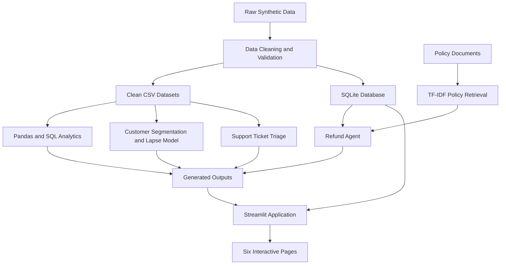

# Instamart Customer Intelligence & Support Copilot

An end-to-end customer intelligence and support analytics application built using Python, SQL, Machine Learning, NLP, Retrieval-Augmented Generation (RAG), and Streamlit.


[**Live Demo**](https://instamart-customer-copilot.streamlit.app/)
[**GitHub Repository**](https://github.com/Cynthia-Jenifer/Instamart-Customer-Intelligence-Copilot)


---

## Project Overview

The Instamart Customer Intelligence & Support Copilot is an educational, end-to-end data and AI project designed around a fictional quick-commerce business.

The project demonstrates how customer, order, product, and support-ticket data can be transformed into useful business insights and intelligent support workflows.

It combines a data engineering pipeline, SQL analytics, customer segmentation, lapse prediction, privacy-aware ticket classification, policy retrieval, and a rule-based refund agent in one interactive Streamlit application.

**The application includes six interactive pages:**

1. **Overview** – Business and operational summary.
2. **Order Explorer** – Explore and filter order information.
3. **Customer Intelligence** – Customer segmentation and retention insights.
4. **Support Tickets** – Ticket classification, routing, and support analysis.
5. **Policy Assistant** – Retrieve relevant policy information using TF-IDF.
6. **Refund Center** – Explore simulated refund decisions and agent workflows.

> **Important:** This is a learning and portfolio project using synthetic data. It is not connected to Swiggy, Instamart, real customer accounts, payment systems, or production support infrastructure. The LLM functionality is simulated locally; no hosted LLM or API key is required.

## Live Application

Explore the deployed Streamlit application:

**[Open Instamart Customer Intelligence & Support Copilot](https://instamart-customer-copilot.streamlit.app/)**

The application uses the project's prepared local datasets, SQLite database, and generated model outputs.

## Business Problem

Quick-commerce platforms generate large volumes of customer, order, and support data. Analysing these datasets separately makes it difficult to identify customer behaviour, detect potential customer lapses, prioritize support tickets, and apply policies consistently.

This project addresses these challenges through an integrated workflow:

- Convert raw exports into validated datasets.
- Analyse sales, orders, and customer behaviour.
- Group customers into meaningful segments.
- Identify customers who may become inactive.
- Classify support tickets while protecting personal information.
- Retrieve relevant policy passages.
- Simulate refund decisions using database-backed tools and policy rules.

## Key Features

| Area | Implementation |
|---|---|
| Data engineering | Data auditing, cleaning, validation, CSV exports |
| Data storage | SQLite database |
| Data analysis | Pandas, SQL, exploratory data analysis |
| Customer segmentation | RFM analysis, K-Means clustering, PCA |
| Customer retention | Lapse prediction using Logistic Regression and Random Forest |
| Ticket intelligence | PII redaction, classification, retries, validation, routing |
| Policy assistant | TF-IDF text retrieval and cosine similarity |
| Refund automation | Database-backed tools, policy checks, simulated refund ledger |
| Dashboard | Interactive Streamlit application with Plotly visualizations |

## Application Architecture



### End-to-End Workflow

1. Generate fictional customer, product, order, ticket, and policy data.
2. Audit and clean raw datasets.
3. Validate data and load cleaned tables into SQLite.
4. Perform SQL and Pandas analysis.
5. Build customer segments and a lapse prediction model.
6. Redact sensitive ticket information and classify support requests.
7. Retrieve relevant policy passages and execute bounded refund-agent workflows.
8. Present insights and simulated support operations through Streamlit.

## Technology Stack

- **Programming:** Python
- **Data processing:** Pandas, NumPy
- **Database:** SQLite
- **Machine Learning:** Scikit-learn
- **Text processing:** TF-IDF, cosine similarity, regular expressions
- **Model persistence:** Joblib
- **Visualization:** Plotly, Matplotlib
- **Dashboard:** Streamlit
- **Development:** Jupyter Notebook, VS Code, Git, GitHub

---

# Technical Implementation

## Part A — Data Engineering and Analytics

### Data Auditing and Cleaning

The project begins with raw CSV exports containing customer, product, order, and support-ticket information.

The data pipeline audits:

- Dataset shape and data types.
- Missing and blank values.
- Duplicate records.
- Invalid or inconsistent values.
- Unique identifiers and key relationships.
- Order statuses and delivery information.

The pipeline uses `keep_default_na=False` when reading CSV exports so blank strings can be inspected explicitly.

### Orders Cleaning Rules

The raw orders data is cleaned using the following sequence:

1. Convert `order_ts` into pandas datetime format.
2. Remove exact duplicate rows using `drop_duplicates()`.
3. Sort records by `order_id` and `order_ts`, retaining only the latest record for each `order_id`.
4. Convert `order_amount` into numeric values.
5. Calculate missing or invalid order amounts using:

   `product price × quantity × (1 − discount percentage / 100)`

6. Convert `delivery_minutes` into numeric values and replace negative values with missing values.
7. Fill missing delivery times for completed orders using the median delivery time of their product category, calculated with `groupby()` and `transform()`.

Cancelled orders are intentionally left with missing delivery times because they were never delivered.

### Data Storage and Validation

Cleaned customer, product, and order datasets are saved as CSV files in `data/clean/`.

The same datasets are loaded into `data/instamart.db` using SQLite.

The database contains three tables:

- `customers`
- `products`
- `orders`

The `order_ts` column is stored as text in the `YYYY-MM-DD HH:MM:SS` format.

The validation script, `src/data_pipeline.py`, checks the cleaned datasets against expected reference checkpoints, including customer distributions, unique order IDs, order statuses, missing values, completed revenue, and SQLite table creation.

Run validation:

```bash
python src/data_pipeline.py
```

When all validation checks pass, the script prints:

```text
ALL CHECKPOINTS PASSED
```

### Exploratory Data Analysis

The EDA focuses on completed orders, revenue, customer locations, product categories, order values, and delivery information.

Key observations from the existing analysis:

- Average order amount: ₹269.91.
- Median order amount: ₹135.00.
- Order amount skewness: approximately 4.61.
- Upper IQR fence: ₹645.30.
- Lower IQR fence: −₹283.50.
- Upper outliers: 897.
- Lower outliers: 0.

The order amount distribution is strongly right-skewed. A relatively small number of high-value orders contribute to the upper tail.

These high-value observations should be investigated rather than automatically removed.

The strongest absolute correlation reported between order amount and discount percentage is approximately −0.095. The correlation between order amount and quantity is approximately +0.087.

Both relationships are very weak; correlation does not establish causation.

### SQL and Pandas Analytics

The project uses SQL and Pandas to explore business questions, including:

- Revenue from completed orders.
- Revenue by city and product category.
- Customer ordering behaviour.
- Product performance.
- Order status distributions.
- Customer and order-level summaries.

SQL examples are available in `sql/queries.sql`.

---

## Part B — Customer Segmentation and Lapse Prediction

### RFM Analysis

RFM analysis groups customers using three behavioural dimensions:

- **Recency:** How recently a customer placed an order.
- **Frequency:** How often a customer placed orders.
- **Monetary:** How much a customer spent.

The project uses completed orders and a fixed snapshot date to construct customer-level RFM features.

### K-Means Clustering

K-Means clustering is used to group customers based on scaled RFM features.

The analysis compares cluster counts from K=2 through K=8 using:

- Inertia.
- Silhouette score.
- Cluster profiles.
- PCA-based visualization.

K=4 is used for the final teaching implementation.

Segment labels are assigned based on segment characteristics, including monetary and frequency behaviour.

The Premium segment represents the segment with the highest average monetary value.

### Why Not Simply Choose K=8?

Inertia measures how close customers are to their assigned cluster centres.

Increasing the number of clusters generally reduces inertia because each cluster becomes smaller and more specialized.

Therefore, K=8 will naturally have lower inertia than K=2. However, more clusters also create more complicated customer groups and may not provide enough additional business value to justify the extra complexity.

The number of clusters should be selected by considering both clustering diagnostics and business interpretability.

### Customer Lapse Prediction

A lapse prediction model identifies customers who may become inactive.

The project uses historical customer behaviour to construct features and September outcomes to define the lapse label.

The modelling workflow includes:

- Feature engineering.
- Train/test splitting with stratification.
- Preprocessing using a Scikit-learn Pipeline.
- GridSearchCV for model selection.
- Logistic Regression and Random Forest.
- Model evaluation.
- Model persistence using Joblib.

The trained model is saved as:

`outputs/lapse_model.joblib`

The retention output is saved as:

`outputs/retention_list.csv`

### Leakage Prevention

The project applies the following safeguards:

- Encoders and scalers are fitted only on training data within the preprocessing pipeline.
- The class-balancing resampler is applied only to the training set.
- The original test set remains unchanged.
- Orders dated on or after 2025-09-01 are not used to construct lapse-model features.
- September orders are used only to define the lapse target.
- Segment labels from Task 3 are not included as features in the lapse prediction model.

**Important limitation:** The Premium flag is derived from whole-window RFM data, which includes the September period used to define the lapse label. Therefore, the Premium retention list is illustrative and is not a leakage-free evaluation. The lapse model's predictive features themselves use only historical orders before the September 1 cutoff.

---

## Part C — Privacy-Aware Support Ticket Triage

The ticket triage pipeline classifies incoming support tickets into four categories:

- Billing
- Delivery
- Technical
- Fraud

### Privacy and Input Guardrails

Before classification:

- Empty tickets are skipped.
- Overlong tickets are skipped before model calls.
- Input token limits are enforced.
- Email addresses are redacted.
- Phone numbers are redacted.
- Order IDs are redacted.

### Classification and Validation

The pipeline demonstrates:

- Zero-shot and few-shot prompting.
- Simulated transient errors.
- Retry logic with delay and jitter.
- JSON output validation.
- Allow-listed classification categories.
- Keyword-based fallback for certain malformed outputs.

Retries are limited to a maximum number of attempts.

Invalid or uncertain outputs are routed for human review instead of being treated as reliable classifications.

### Support Routing

Tickets are routed based on classification and customer information:

- Fraud tickets → Security team.
- Premium customer tickets → Premium support desk.
- Standard tickets → Support queue.
- Invalid, guardrail, or uncertain cases → Human review.

### Zero-Shot vs Few-Shot Comparison

The existing experiment produced the following results:

| Metric | Zero-shot | Few-shot |
|---|---:|---:|
| Classified tickets | 147 | 147 |
| Correct predictions | 126 | 147 |
| Accuracy | 85.7% | 100% |

The zero-shot prompt incorrectly classified 11 fraud tickets and 10 technical tickets as billing.

The few-shot prompt eliminated these classification errors in the experiment.

The few-shot approach requires additional prompt tokens. This illustrates the trade-off between token usage and classification quality. The exact token-cost difference should be taken from the corresponding pipeline run output rather than assumed.

---

## Part D — Policy Retrieval and Refund Agent

### Policy Assistant: TF-IDF Retrieval

The policy assistant retrieves relevant passages from five policy documents:

- Delivery policy.
- Escalation policy.
- Payment policy.
- Privacy policy.
- Refund policy.

The retrieval workflow:

1. Reads policy documents.
2. Splits documents into overlapping text chunks.
3. Converts chunks into TF-IDF vectors using `TfidfVectorizer`.
4. Calculates cosine similarity between the query and policy chunks.
5. Ranks the most relevant passages.
6. Uses the retrieved context in the offline mock response.

### TF-IDF and Its Limitations

Term Frequency (TF) measures how frequently a word appears in a document.

Inverse Document Frequency (IDF) gives more importance to words that are uncommon across the collection of documents.

TF-IDF combines these measurements to represent text numerically.

Cosine similarity compares the direction of two vectors to estimate their similarity.

**Limitation:** TF-IDF relies on word matching rather than understanding meaning. Two sentences with different wording but the same meaning may not be recognized as similar.

### Refund Agent

The refund agent uses database-backed Python tools to verify order information and apply refund rules.

The agent demonstrates:

- Order lookup using SQLite.
- Policy search.
- Refund calculation.
- Refund eligibility checks.
- Refund escalation.
- Simulated refund issuance.
- JSONL refund ledger.
- Bounded tool execution.

### Refund Rules

The teaching implementation follows these rules:

1. Only completed orders are eligible for refund evaluation.
2. Completed orders delivered in more than 45 minutes qualify for a full refund.
3. Orders delivered in 45 minutes or less do not qualify under the delivery-delay rule.
4. Refund amounts above ₹1,000 are escalated rather than automatically issued.
5. Refund requests are evaluated within the simulated seven-day request window.

This is a simulated workflow, not a payment integration. No real money is transferred.

### Safe Stopping and Fallback Demonstrations

The refund agent implements three safety limits.

**1. Maximum iterations**

Stops after `max_iterations` model calls without a final answer.

Scenario S7 ends with:

`FALLBACK_MAX_ITERATIONS`

**2. Token limit**

Tracks `usage.total_tokens` after every model call.

If the total exceeds the configured limit, the agent stops before executing the requested tool.

Scenario S1 with `token_limit=200` ends with:

`FALLBACK_TOKEN_LIMIT`

**3. Time limit**

Checks elapsed wall-clock time using `time.monotonic()` at the beginning of every iteration.

Scenario S1 with `time_limit_seconds=0` ends with:

`FALLBACK_TIMEOUT`

All fallback responses preserve completed tool steps and return a human-handoff summary in `final_answer`.

### Resumable Agent and Checkpoint Recovery

The refund agent saves a checkpoint in:

`state/{run_id}.json`

A checkpoint contains:

- Run ID.
- Scenario ID.
- Full message history.
- Tokens used.
- Step number.
- Executed tools.
- Completed steps.

This enables an interrupted workflow to resume without repeating completed tool executions.

### S1 Crash-and-Resume Demonstration

The project demonstrates a simulated crash immediately after the second tool execution, after its checkpoint has been saved.

`resume_agent(run_id)` loads the saved state and continues the workflow.

Tools executed across both parts:

1. `get_order`
2. `search_policy`
3. `calculate_refund`
4. `issue_refund`

Results:

- Total tool executions: **4**
- Final status: **REFUND**
- Refund amount: **₹128.25**

The resumed run continues from the saved message history and preserves the original execution history.

### ReAct vs Plan-and-Execute

The ReAct agent follows an observe-and-act cycle, making multiple model calls.

For example:

- S1 requires 5 model calls.
- S5 requires 3 model calls.
- S6 requires 2 model calls.

Each call adds to token usage, making ReAct relatively more expensive in terms of model calls and tokens.

A Plan-and-Execute agent would ask the model once to generate a complete sequence of steps and then execute those steps using tools. It would call the model again only if an error or unexpected result required replanning.

However, ReAct handles unexpected observations more naturally.

For example, if an order returns `NOT_FOUND` or has a cancelled status, the agent can observe the tool result and decide not to issue a refund.

A pre-generated plan may not account for every possible observation, so additional error handling and replanning would be necessary.

For this refund workflow, ReAct is the preferred teaching approach because refund decisions require checking order status, delivery time, policy conditions, and escalation thresholds. Verifying each observation before taking the next action prioritizes safety and correctness over minimizing model calls.

---

# Repository Structure

The repository is organized as follows:

```text
Instamart-Customer-Intelligence-Copilot/
│
├── .gitignore
│
└── instamart_customer_copilot/
    │
    ├── streamlit_app.py
    ├── generate_data.py
    ├── run_project.py
    ├── mock_llm.py
    ├── requirements.txt
    ├── README.md
    │
    ├── data/
    │   ├── raw/
    │   ├── clean/
    │   ├── policies/
    │   └── instamart.db
    │
    ├── notebooks/
    │   └── Customer_Intelligence_Support_Copilot.ipynb
    │
    ├── outputs/
    │   ├── customer_segments.csv
    │   ├── lapse_model.joblib
    │   ├── retention_list.csv
    │   ├── triage_results.csv
    │   ├── refund_ledger.jsonl
    │   └── agent_runs.jsonl
    │
    ├── reports/
    │   ├── city_revenue.png
    │   └── order_value_distribution.png
    │
    ├── sql/
    │   └── queries.sql
    │
    └── src/
        ├── __init__.py
        ├── data_pipeline.py
        ├── pandas_analysis.py
        ├── run_sql.py
        ├── customer_models.py
        ├── triage.py
        ├── policy_rag.py
        ├── refund_agent.py
        └── mock_llm.py
```

---

# Installation and Local Execution

## Prerequisites

- Python 3.11 or later recommended.
- Git.
- VS Code or another Python IDE.
- A virtual environment.

## 1. Clone the repository

```bash
git clone https://github.com/Cynthia-Jenifer/Instamart-Customer-Intelligence-Copilot.git
```

## 2. Navigate to the application directory

```bash
cd Instamart-Customer-Intelligence-Copilot/instamart_customer_copilot
```

## 3. Create a virtual environment

```bash
python -m venv .venv
```

Activate it in Windows PowerShell:

```powershell
.venv\Scripts\Activate.ps1
```

For macOS/Linux:

```bash
source .venv/bin/activate
```

## 4. Install dependencies

```bash
python -m pip install --upgrade pip
python -m pip install -r requirements.txt
```

## 5. Generate synthetic data

```bash
python generate_data.py
```

## 6. Run the project pipeline

```bash
python run_project.py
```

## 7. Launch the Streamlit application

```bash
python -m streamlit run streamlit_app.py
```

The application will open in your browser.

## 8. Run the Jupyter Notebook

Open:

`notebooks/Customer_Intelligence_Support_Copilot.ipynb`

Run the cells from top to bottom to explore the implementation and analysis.

The notebook uses the same core modules as the scripts.

---

# Limitations and Future Improvements

This project is an educational implementation using synthetic data and simulated AI workflows.

Current limitations:

- No live customer or order data integration.
- No production authentication or role-based access control.
- The offline mock model is deterministic, rule-based simulation rather than a real language model.
- TF-IDF retrieval relies on lexical similarity rather than semantic embeddings.
- The refund ledger is a local JSONL audit trail, not a real transaction system.
- The lapse model is trained and evaluated on synthetic data; its results should not be interpreted as production performance.
- The Premium retention list has the RFM time-window limitation described in Part B.

Potential future improvements:

- Integrate approved, secure data sources.
- Add role-based access control and authentication.
- Explore semantic retrieval and embedding-based RAG.
- Integrate a hosted LLM with appropriate safeguards.
- Add automated tests and continuous integration.
- Add model monitoring and drift detection.
- Introduce human approval for sensitive support and refund actions.
- Add observability, data lineage, and audit reporting.

# Learning Resources

These public projects and documentation resources are useful for understanding the technologies used:

- [Pandas](https://github.com/pandas-dev/pandas) — Data manipulation and analysis.
- [Scikit-learn](https://github.com/scikit-learn/scikit-learn) — Machine learning, preprocessing, clustering, model selection, and text feature extraction.
- [Python Tutorial](https://github.com/python/cpython/tree/main/Doc/tutorial) — Python fundamentals.
- [Jupyter Notebook](https://github.com/jupyter/notebook) — Interactive notebook workflows.
- [SQLite](https://github.com/sqlite/sqlite) — Lightweight relational database.
- [Scikit-learn Text Feature Extraction](https://scikit-learn.org/stable/modules/feature_extraction.html#text-feature-extraction) — TF-IDF and text vectorization.

---

## Acknowledgement

This project was developed as a hands-on learning implementation to explore data engineering, analytics, machine learning, NLP, RAG, and agentic workflows through a single business-oriented application.

**Built with Python, SQL, Machine Learning, NLP, and Streamlit.**